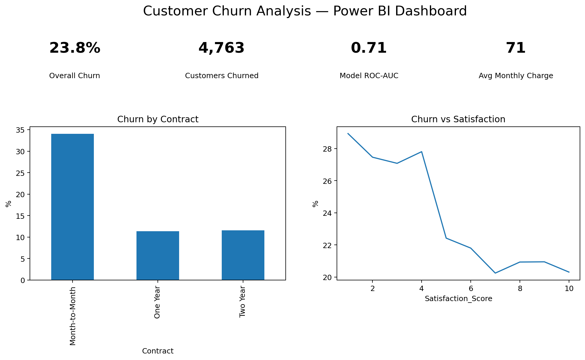
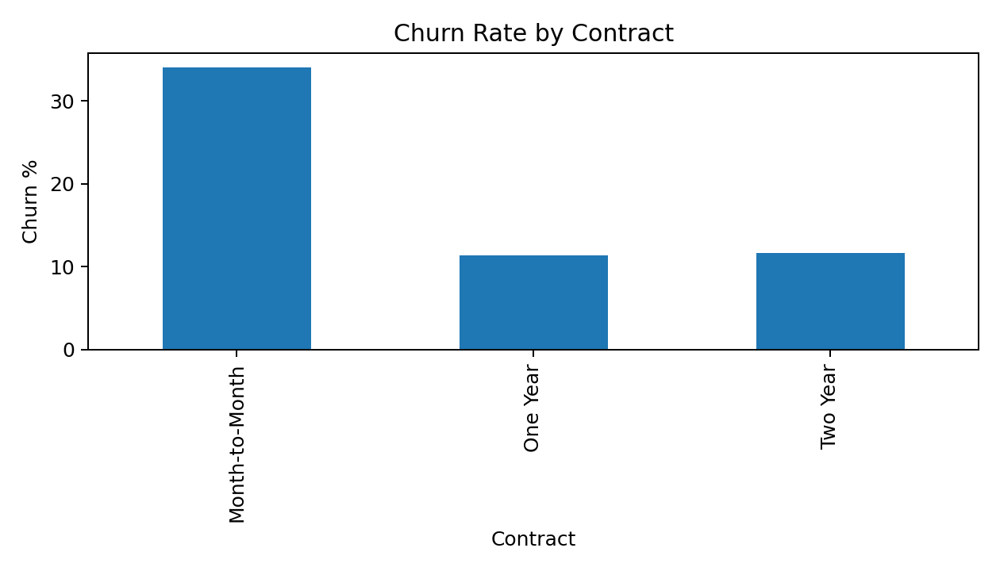
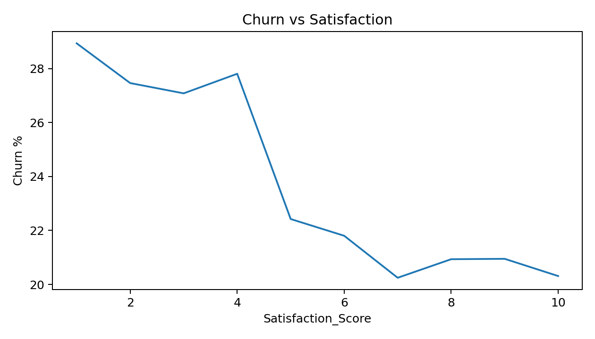

# Customer Churn Analysis

## Project Overview
A complete customer analytics project identifying churn patterns from demographic and behavioural data using Python, SQL and Power BI.

## Business Problem
Identify high-risk customer segments and the behavioural factors associated with churn so retention teams can prioritise interventions.

## Project Objectives
- Analyse customer demographics, tenure, pricing and behavioural patterns.
- Identify the strongest drivers of customer churn.
- Build a classification model to identify customers at higher churn risk.
- Create a Power BI-ready dashboard for business reporting.
- Translate analytical results into practical retention recommendations.

## Tools & Technologies
**Python:** Pandas, NumPy, Matplotlib, Scikit-learn  
**SQL:** Aggregation, segmentation and KPI analysis  
**Power BI:** KPI cards, slicers and interactive churn visuals  

## Dataset
**20,000 realistic customer records** containing age, tenure, monthly charges, contract type, internet service, support calls, late payments, satisfaction score and churn status.

## Key Results

| KPI | Result |
|---|---:|
| Customers analysed | **20,000** |
| Overall churn rate | **21.0%** |
| Highest-risk contract | **Month-to-Month** |
| Best classification model | **Random Forest** |
| Random Forest ROC-AUC | **0.84** |

## Results & Findings

### 1. Overall churn
**21.0% of customers churned.** This establishes a significant retention opportunity and provides the baseline KPI for the dashboard.

### 2. Contract risk
**Month-to-Month customers have the highest churn risk.** These customers should be prioritised for retention campaigns and contract-conversion offers.

### 3. Customer satisfaction
**Lower satisfaction is associated with higher churn.** Customers reporting poor experiences should be identified early for service recovery and targeted engagement.

### 4. Support interactions
Customers with **more support interactions** show greater churn risk, indicating that repeated service issues can be an early warning signal.

### 5. Predictive modelling
Two classification approaches were evaluated. **Random Forest achieved a ROC-AUC of 0.84**, making it the stronger model in this project for ranking customers by churn risk.

## Business Recommendations

1. Prioritise month-to-month customers for proactive retention campaigns.
2. Trigger follow-up actions for customers with low satisfaction scores.
3. Monitor repeated support interactions as an early churn-warning indicator.
4. Use the Random Forest risk score to prioritise retention-team effort.
5. Track churn KPIs in Power BI to measure whether retention actions reduce churn over time.

## Power BI Dashboard Output

The dashboard is designed to show:
- Overall churn rate
- Number of churned customers
- Model performance
- Churn by contract type
- Churn by satisfaction score
- Churn by internet service
- High-risk customer segments
- Interactive filters for business analysis

### Dashboard Preview



### Supporting Analysis





## Project Structure
```text
data/
  customer_churn_20000.csv
notebooks/
  customer_churn_analysis.ipynb
sql/
  churn_analysis.sql
dashboard/
  PowerBI_Dashboard_Guide.md
images/
  dashboard_overview.png
  churn_by_contract.png
  churn_vs_satisfaction.png
requirements.txt
README.md
```

## How to Run
```bash
pip install -r requirements.txt
jupyter notebook notebooks/customer_churn_analysis.ipynb
```

## Conclusion
This project demonstrates an end-to-end customer churn analytics workflow: **data preparation → exploratory analysis → SQL analysis → predictive modelling → dashboard reporting → business recommendations**.